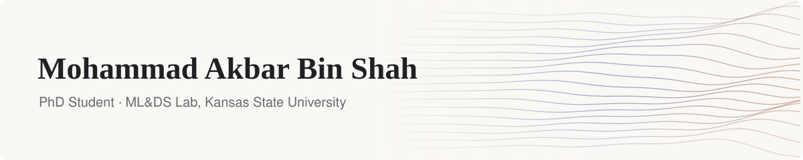

<picture>
  <source media="(prefers-color-scheme: dark)" srcset="assets/banner-dark.svg">
  
</picture>

  
  
  
  
  

PhD student in Computer Science at **Kansas State University**, in the **ML&DS Lab**. My research is in machine learning and deep learning, including computer vision, domain adaptation and federated learning.

### Selected repositories

| Repository | About |
|---|---|
| [**sam2-realtime**](https://github.com/mohammadakbar2603/sam2-realtime) | Real-time video object tracking with SAM 2 |
| [**extruder-sam2**](https://github.com/mohammadakbar2603/extruder-sam2) | Measuring extruded food products from high-speed video |
| [**diabetic_retinopathy_federated_learning**](https://github.com/mohammadakbar2603/diabetic_retinopathy_federated_learning) | Diabetic retinopathy classification with federated learning |
| [**credit_scoring_engine_for_loan_disbursement**](https://github.com/mohammadakbar2603/credit_scoring_engine_for_loan_disbursement) | Credit scoring for loan eligibility, with a React and Django interface |
| [**cuet-medical-center**](https://github.com/mohammadakbar2603/cuet-medical-center) | Web app for the CUET Medical Center |
| [**grocersss**](https://github.com/mohammadakbar2603/grocersss) | Online grocery store built with React and Redux |
| [**admin-grocersss**](https://github.com/mohammadakbar2603/admin-grocersss) | Admin dashboard for the grocery store: products, orders and customers |
